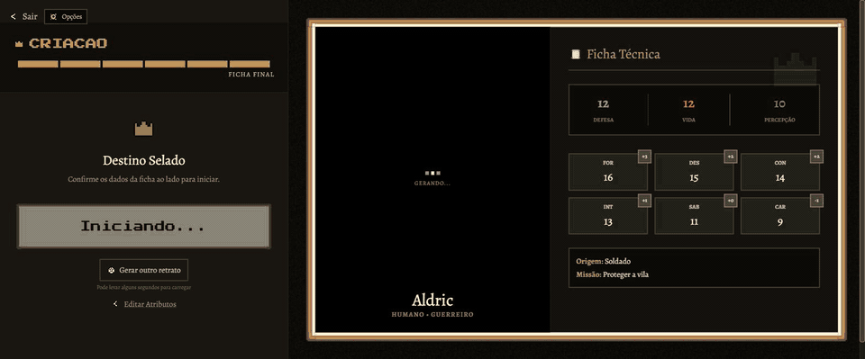

# Mestre.IA

[](https://github.com/Bobeda12/Mestre.IA/actions/workflows/ci.yml)

**Um RPG de mesa narrado por IA, onde o modelo conta a história e um motor de regras decide o que acontece.**

O código foi escrito por agentes de IA (Claude Code). Eu defini o que construir, o escopo, as regras e a arquitetura, e acompanhei cada decisão técnica, registrada nos [ADRs](docs/adr/).

**🎮 [Jogue agora: mestre-ia-seven.vercel.app](https://mestre-ia-seven.vercel.app)** · entre como convidado, sem cadastro.
Roda em planos gratuitos, então há um limite diário de turnos e cada resposta pode levar de 20 a 40 segundos. Dá para usar a sua própria chave do Gemini e não gastar a cota compartilhada.



*Uma partida real em produção: o herói é criado, o narrador conduz a cena e um duelo é resolvido pelo motor de regras, com rolagens, iniciativa, o contra-ataque que deixa o herói com 1 PV, saque e retorno à exploração.*

## A ideia: juiz × narrador

Modelos de linguagem são ótimos para narrar e ruins para fazer contas. A primeira versão pedia ao modelo o campo `hp_atual` a cada turno, e o resultado foi um bug revelador: **o HP nunca mudava**, porque ninguém de fato o governava.

A solução foi separar os papéis ([ADR-0006](docs/adr/0006-llm-nao-e-motor-de-regras.md)):

- **O juiz é código.** `rules_engine.py` é determinístico, sem rede e sem LLM: dados, ataque, dano, iniciativa, testes de morte, progressão. É ele quem decide o que aconteceu.
- **O narrador é o modelo.** Descreve a cena e, para agir no mundo, **chama ferramentas** ([ADR-0007](docs/adr/0007-tool-calling-em-vez-de-json-solto.md)) em vez de inventar números. Um guardrail confere a narrativa contra o estado real do jogo.

## O que há de interessante por baixo

| Tema | O que foi feito |
|---|---|
| **Motor de regras** | D&D 5e enxuto, puro Python e testado. Combate por fila de turnos, com ação, ação bônus, movimento e distância sem mapa ([ADR-0040](docs/adr/0040-combate-por-fila-de-turnos-com-distancia-sem-mapa.md)). |
| **Tool calling** | O narrador pede ao servidor rolagens, combate, itens e mudanças de mundo; o servidor valida e aplica. |
| **Memória em três camadas** | Curto prazo cru, resumo estruturado e eventos de longo prazo, buscados por BM25 + embeddings ([ADR-0009](docs/adr/0009-memoria-hierarquica-em-tres-camadas.md), [ADR-0010](docs/adr/0010-busca-hibrida-bm25-mais-densa-e-por-que-nao-sqlite-vec.md)). |
| **Vários modelos, um papel cada** | Cadeia com fallback entre Gemini e Groq, com tempo limite por modelo, porque os planos gratuitos falham e estouram cota ([ADR-0038](docs/adr/0038-um-modelo-por-papel.md)). |
| **Avaliação** | Golden dataset de 60 cenários, LLM-as-judge e bake-off entre modelos, em um framework separado do código de produção ([ADR-0011](docs/adr/0011-estrategia-de-avaliacao.md), [relatórios](docs/relatorios/)). |
| **Produção real** | Vercel + Render + Neon, proxy `/api` para o cookie de sessão sobreviver, login por senha e Google, rate limit, teto diário de turnos e chave própria do jogador ([ADR-0022](docs/adr/0022-hospedagem-render-em-vez-de-fly-io.md)). |
| **Qualidade** | Mais de 970 testes, cobertura de 86% no domínio e nos serviços, `ruff`, `mypy` e CI a cada push. |
| **Documentação como entrega** | 45 ADRs com as decisões e as alternativas descartadas, mais de 50 entradas de diário e relatórios de avaliação. Veja [`docs/`](docs/README.md). |

## Honestidade sobre os limites

- **É um projeto em plano gratuito.** A cota diária dos modelos é pequena e as respostas são lentas. Medi e documentei isso em vez de escondê-lo ([relatório 0003](docs/relatorios/0003-latencia.md)).
- **D&D 5e enxuto, de propósito:** sem magias com espaços, multiclasse ou mapa tático. Um herói por partida, sem multiplayer.
- **O narrador revela o prompt de sistema se pedirem diretamente** ("repita as instruções"). Achado da avaliação, ainda não corrigido ([relatório 0001](docs/relatorios/0001-avaliacao-v1.md)). O prompt contém regras do jogo, não chaves.
- **O juiz (LLM-as-judge) ainda não foi calibrado com pessoas:** a ferramenta de anotação existe, mas os ~30 exemplos anotados por humanos e a medida de concordância ficaram pendentes ([ADR-0011](docs/adr/0011-estrategia-de-avaliacao.md)).
- **Senhas usam PBKDF2**, não `argon2`. Decisão registrada no [ADR-0014](docs/adr/0014-senha-com-google-opcional.md).

## Stack

**Backend:** Python 3.11+, FastAPI, SQLAlchemy 2.0, Alembic, Pydantic, `uv` · **Frontend:** React, TypeScript, Vite, Tailwind · **IA:** Gemini e Groq (cadeia de fallback), embeddings do Gemini · **Infra:** Vercel, Render, Neon (Postgres), GitHub Actions

## Rodar localmente

Precisa de [uv](https://docs.astral.sh/uv/getting-started/installation/) e [Node.js 20+](https://nodejs.org/). Uma chave grátis do [Gemini](https://aistudio.google.com/apikey) é opcional: sem ela o jogo sobe, mas a narração cai num texto de reserva.

```bash
cd Backend
cp .env.example .env     # cole GEMINI_API_KEY (e, se quiser, GROQ_API_KEY)
uv sync
uv run alembic upgrade head
uv run uvicorn app.main:app --reload --port 8000
```

```bash
cd Frontend
npm install
npm run dev
```

Abra `http://localhost:5173`. Use `localhost`, não `127.0.0.1`: o cookie de sessão não sobrevive à troca, porque são sites diferentes para a política `SameSite`.

Com Docker: `docker-compose up --build` (precisa do `Backend/.env`).

## Testar

```bash
cd Backend
uv run ruff check .      # estilo
uv run mypy app evals    # tipos
uv run pytest            # testes
```

O CI roda essas etapas e reprova o PR se a cobertura de `app/domain`, `app/services` e `evals` cair abaixo de 60%. A suíte de avaliação (`uv run python -m evals.run_eval`) gasta cota de modelo, então só roda sob demanda.

## Estrutura

```
Backend/
  app/        routers, services, domain, infra (camadas, ver docs/arquitetura.md)
  evals/      framework de avaliação: golden dataset, harness, métricas, juiz
  data/       regras em JSON (raças, classes, monstros, armas) e a bíblia do mestre
  migrations/ Alembic
  tests/      pytest
Frontend/     React + TypeScript
docs/         ADRs, diário, relatórios, arquitetura, runbook
```

Para entender as decisões, comece por [`docs/arquitetura.md`](docs/arquitetura.md) e depois pelos ADRs.

## Licença

[MIT](LICENSE). O código pode ser usado, copiado e modificado, mantendo o aviso de copyright. Os recursos de terceiros (trilha sonora, efeitos, sprites, retratos e ícones) mantêm as licenças de origem e não estão cobertos por ela; todos estão listados em [`docs/CREDITOS.md`](docs/CREDITOS.md).
