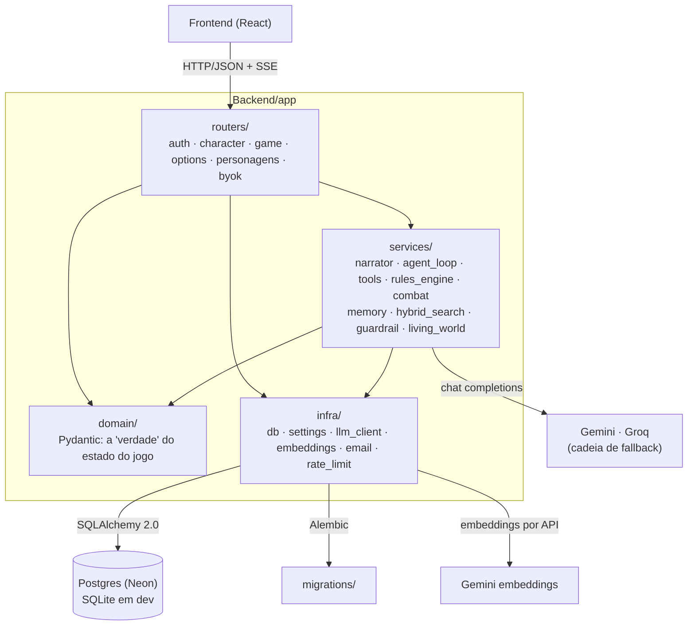

# Arquitetura do backend

O backend é um pacote em camadas (`Backend/app/`). A divisão e o porquê dela estão no [ADR-0003](adr/0003-camadas-router-service-domain-infra.md).

## As camadas

- **`routers/`** só fala HTTP: valida a requisição com os modelos de `domain/`, chama um serviço e devolve a resposta. Não conhece regras de D&D nem o LLM.
- **`services/`** é a lógica.
  - `rules_engine.py` é determinístico, sem I/O e sem LLM: dados, ataque, dano, iniciativa, testes de morte.
  - `combat.py` liga o bestiário ao motor ([ADR-0006](adr/0006-llm-nao-e-motor-de-regras.md)).
  - `agent_loop.py` e `tools.py` são o tool calling ([ADR-0007](adr/0007-tool-calling-em-vez-de-json-solto.md)).
  - `narrator.py` fala com os modelos e converte cada tipo de falha numa mensagem própria.
  - `memory.py` e `hybrid_search.py` são a memória em três camadas e a busca BM25 + embeddings ([ADR-0009](adr/0009-memoria-hierarquica-em-tres-camadas.md), [ADR-0010](adr/0010-busca-hibrida-bm25-mais-densa-e-por-que-nao-sqlite-vec.md)).
  - `guardrail.py` confere a narrativa contra o estado real do jogo.
- **`domain/`** são os modelos Pydantic que dão forma ao estado (`world_state`, `combat_state`, a ficha, o resumo rolante), em vez de dicionários soltos.
- **`infra/`** é tudo que fala com o mundo externo: banco, configuração (`pydantic-settings`), o cliente de modelos com cadeia de fallback e tempo limite por modelo, embeddings pela API do Gemini ([ADR-0023](adr/0023-embeddings-via-api-gemini.md)), envio de e-mail e rate limit.

## Decisões relacionadas

- Um modelo por papel, com cadeia de fallback: [ADR-0038](adr/0038-um-modelo-por-papel.md)
- Login por senha, com Google opcional, e autorização por recurso: [ADR-0014](adr/0014-senha-com-google-opcional.md)
- Migrations com Alembic: [ADR-0004](adr/0004-alembic-para-migrations.md)
- Hospedagem: [ADR-0022](adr/0022-hospedagem-render-em-vez-de-fly-io.md) e o [runbook](runbook.md)
- Estratégia de avaliação: [ADR-0011](adr/0011-estrategia-de-avaliacao.md)
